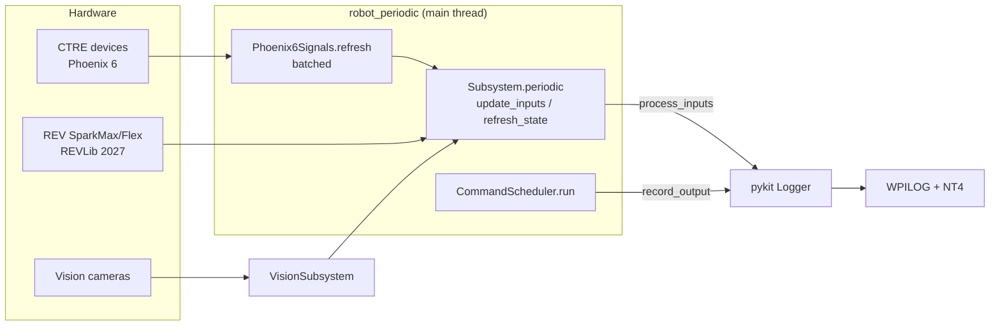
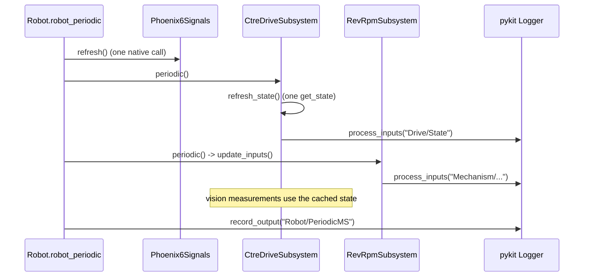
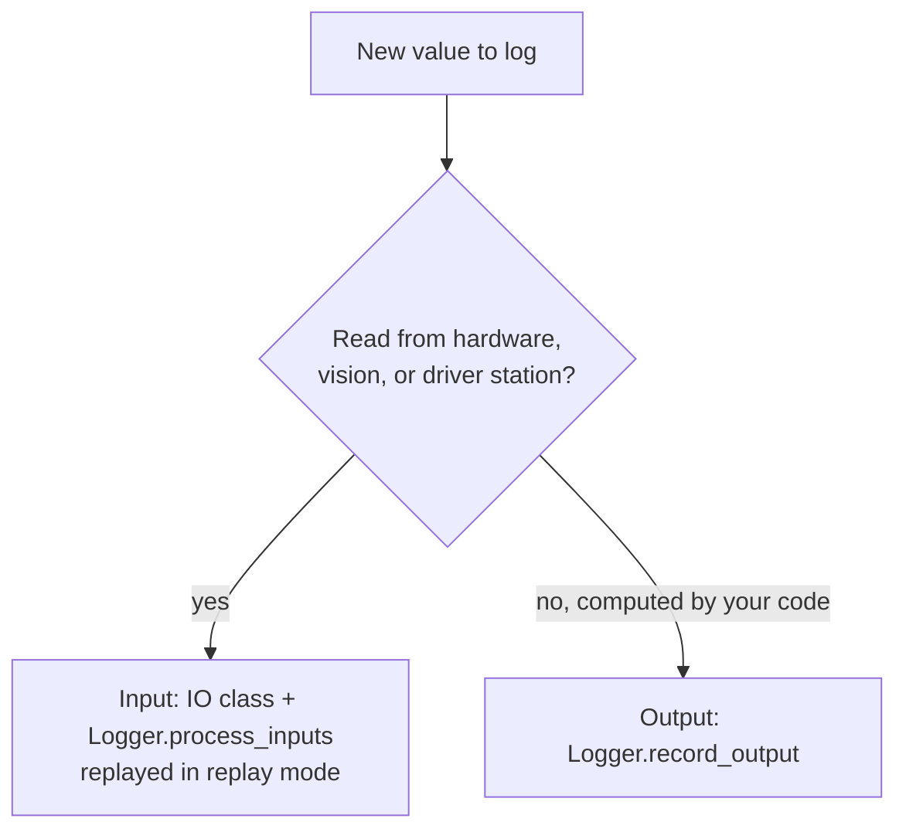

# lib_6107 Telemetry: Work Performed, Users Guide and Best Practices

Audience: intermediate to advanced Python/FRC developers using `lib_6107` (RobotPy / WPILib 2027).
Background and recommendation IDs (R1–R14) come from [telemetry-2027-review.md](telemetry-2027-review.md).

## 1. Goals

- **pykit is the only logging sink.** Everything that should be replayable goes through `Logger`.
- **No duplicated functionality.** One owner per signal, one native read per cycle.
- **No extra threads.** Vendor logger threads are opt-in and off in matches.
- **Protect the 20 ms periodic.** Batch native calls, cache state, and monitor the time budget.

## 2. Work performed

### Bug fixes (Phase 0)

| Area | Fix |
|---|---|
| `util/rev/utils.py::handle_faults` | Unwraps REV `Signal` objects, skips invalid signals, derives flag names from the `Faults`/`Warnings` objects, and reports a given device failure once (no per-cycle alert spam). |
| `rev_rpm_subsystem.py` | Adds a `can_port` argument that is passed to `SparkMax`/`SparkFlex`; corrected PWM docstrings. |
| `robotcontainer.py` (tuner-x) | snake_case API and `DriverStation` usage. |

### Phase 1 – Vendor inputs

| ID | Change |
|---|---|
| REV signals | `util/rev/signals.py`: `read_signal`, `signal_error`, `apply_signal_periods` (20 ms for control signals, 250 ms for slow ones). |
| IO fields | `RpmMechanismIO` inputs gain `mechanism_temperature`, `mechanism_faults_raw`, `mechanism_warnings_raw`, `mechanism_last_error`. |
| REV `update_inputs` | Reads each signal once, converts units once, and ties `mechanism_connected` to signal validity. |
| CTRE refresh | `Phoenix6Signals.refresh()` is active in `robot_periodic` (one batched call). `unregister_signal()`/`clear()` added. |

### Phase 2 – Drivetrain and vision

| Change | Effect |
|---|---|
| `CtreDriveSubsystem.refresh_state()` | One native `get_state()` per cycle; `get_state`, `get_pose`, … return the cached snapshot. |
| `Drive/State` pykit inputs (`DriveStateIO`) | Pose, velocity, raw heading, odometry period and DAQ success/fail counts are replayable. Modules and gyro remain under `Drive/Module-*` and `Drive/Gyro`. |
| Vision guards | `add_vision_measurement` rejects future, stale (> 1 s) and over-cap (4 per cycle) measurements, returns `bool`, and logs `Drive/Vision/*`. |
| Vision std-dev bug | The tuple was `(factor, linear, angular)`; it is now `(x, y, theta)`. |
| Removed `SwerveTelemetry` (tuner-x) | It ran on the native odometry thread, built per-module `Mechanism2d` objects, and duplicated pykit. |
| Cleanups | SysId rotation now logs `SysIdRotation_State` (was `SysIdSteer_State`); the duplicate sim `Notifier` is no longer started when the tuner drivetrain has one. |

### Phases 3–4 – Diagnostics and budget

- `util/telemetry_mode.py`: opt-in `SignalLogger`/`StatusLogger` (see section 5). The default is off.
- `Robot.robot_periodic` logs `Robot/PeriodicMS`, `Robot/PeriodicOverBudget` and `Robot/PeriodicBudgetOverruns`
  against `Robot.PERIODIC_BUDGET_SECONDS` (default 15 ms). `LogTracer` has a `DriveState` segment.

### Tests added or updated

`tests/util/test_rev_utils.py`, `test_rev_signals.py`, `test_signals.py`, `test_telemetry_mode.py`,
`tests/subsystems/test_rev_rpm_subsystem.py`, `test_ctre_drivesubsystem.py`, `tests/pykit/test_pykit_io.py`,
`tests/test_robot.py`. A conftest fixture clears `Phoenix6Signals` between tests.

## 3. Architecture



### One cycle



### Why inputs vs outputs



## 4. Users guide

### 4.1 Logging a subsystem's hardware readings (inputs)

Define an IO inputs class (an `@autolog` dataclass), fill it once per cycle, then call `process_inputs`.

```python
from lib_6107.pykit.logger import Logger


class MySubsystem(SubsystemBase):
    def periodic(self) -> None:
        self._io.update_inputs(self._inputs)  # one read per signal
        Logger.process_inputs("MySubsystem", self._inputs)
```

### 4.2 Logging derived values (outputs)

```python
Logger.record_output("MySubsystem/AtSetpoint", self.at_setpoint())
```

Outputs are not replayed; they are recomputed from the logged inputs.

### 4.3 CTRE devices

Register signals once at construction; `robot_periodic` refreshes all of them in a single call.

```python
from lib_6107.util.phoenix6.signals import Phoenix6Signals

Phoenix6Signals.register_signal(motor.get_velocity())  # at init
velocity = motor.get_velocity().value_as_double  # in update_inputs: no extra refresh
```

Never call `refresh()` or `get_*()` with a wait on a signal that is registered.

### 4.4 REV devices

```python
from lib_6107.util.rev.signals import read_signal, signal_error

rpm = read_signal(encoder.get_velocity(), default=0.0)  # invalid signal -> default
error = signal_error(encoder.get_velocity())
```

`apply_signal_periods(config)` is applied by `RevRpmSubsystem` so only the signals you use are sent over CAN.
Fault and warning bitmasks are logged raw (`mechanism_faults_raw`) and decoded by `handle_faults`, which alerts once
per device.

### 4.5 Drivetrain and vision

```python
accepted = drive.add_vision_measurement(pose, timestamp, (0.3, 0.3, 0.5))  # x, y, theta std devs
```

- Timestamps must be in the FPGA timebase (`utils.get_current_time_seconds()` compatible).
- A `False` return means the measurement was rejected. Check `Drive/Vision/LastRejectReason`
  (`future_timestamp`, `stale_timestamp`, `per_cycle_cap`).
- Do not call `drive.get_state()` expecting fresh data between periodic calls; it is the cycle snapshot.

### 4.6 Vendor diagnostic logging (bench only)

```python
from lib_6107.util import telemetry_mode

telemetry_mode.enable_diagnostic_logging()  # SignalLogger + StatusLogger
...
telemetry_mode.disable_diagnostic_logging()
```

Use for SysId, CTRE Tuner / REV Hardware Client analysis and calibration. They write their own files and run native
threads, so leave them off in matches.

### 4.7 Watching the time budget

AdvantageScope: plot `Robot/PeriodicMS`, `Robot/PeriodicBudgetOverruns` and the `LogTracer` segments
(`PhoenixUpdate`, `ContainerPeriodic`, `CommandsPeriodic`, `DriveState`). Override the limit with
`PERIODIC_BUDGET_SECONDS` on your `Robot` subclass.

## 5. Best practices

1. **One read per signal per cycle.** Read into a local, convert, and store; do not re-call getters.
2. **Inputs are facts, outputs are conclusions.** Put anything that comes from hardware or vision in an inputs class
   so replay works.
3. **No threads, no vendor callbacks.** Callbacks such as `register_telemetry` run on the odometry thread; they must
   not touch NetworkTables, `Logger`, or build objects.
4. **Prefer stable key names.** Keys are `Subsystem/Name`; renaming breaks AdvantageScope layouts.
5. **Log raw values, derive later.** Log bitmasks and raw units; decode in tooling or in cheap one-time alerts.
6. **Guard external data.** Validate timestamps, signal validity and rates before using them (vision, CAN signals).
7. **Report faults once.** Alert on state change, not every cycle.
8. **Mind the budget.** Keep periodic under about 15 ms; add `LogTracer.record("Name")` after costly blocks.
9. **Vendor loggers are diagnostics only.** Enable temporarily and disable afterwards.
10. **Test with mocks.** Build signals/objects without hardware (for example `Signal_double(v, err, ts)`),
    patch `Logger`, and assert call counts (see `tests/subsystems/test_ctre_drivesubsystem.py`).

## 6. Troubleshooting

| Symptom | Likely cause |
|---|---|
| `Robot/PeriodicOverBudget` is frequently true | Look at the `LogTracer` segments; reduce per-cycle allocations and extra native calls. |
| Vision never applied | Check `Drive/Vision/LastRejectReason`; timestamp not in FPGA time is the usual cause. |
| REV values always zero | Signal invalid (see `mechanism_last_error`); check CAN ID, `can_port` and firmware. |
| Tests fail with `encoding without a string argument` | A mock signal was left registered in `Phoenix6Signals`; call `Phoenix6Signals.clear()`. |

## 7. Known follow-ups

- `SubsystemBase.dashboard_initialize` is referenced by two existing tests but does not exist (pre-existing).
- Module-level CAN-bus utilization logging and REV-specific `LogTracer` segments are not implemented.
